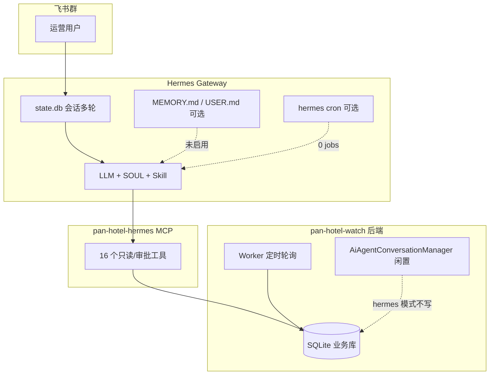
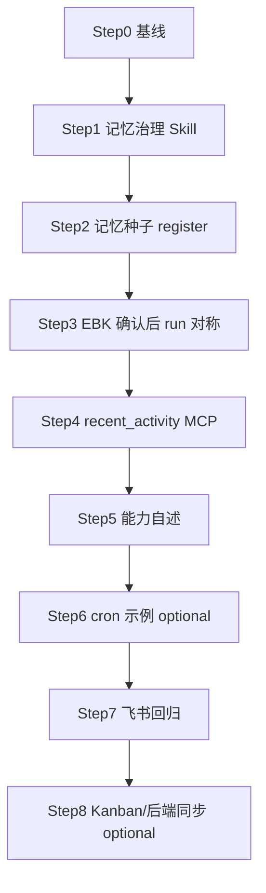

# Hermes 记忆 × 任务 × 边际清晰：审计 + 分步实施计划

> **文档状态（2026-07-23）**：本文是 2026-06-26 的记忆审计与历史实施计划，不是当前路由或能力清单。当前自然语言路由以 `client/domain_intent_router.py`、`docs/hermes-routing-redesign.md` 及飞书插件的 `pre_llm_call` / `pre_tool_call` 为准。MEMORY、USER.md 和会话历史只保存偏好、称呼与上下文；经营数字、价格、配置和审批状态必须来自后端数据库与本轮 MCP 结果，不能从记忆或历史答案恢复。

> 版本: v1.0 | 日期: 2026-06-26 | 状态: 审计完成，待分步实施  
> 前置：`hermes-integration-plan.md` §12 深度对接（路由 / chat context / MCP）已落地。

---

## 一、代码审计结论（先审计、不大改）

### 1.1 当前架构（记忆与任务相关）



| 层级 | 能力 | 实际状态 |
|------|------|----------|
| **会话记忆** | `group_sessions_per_user: true`，同群同用户多轮 | ✅ 已启用（`~/.hermes/state.db`） |
| **Hermes 持久记忆** | `MEMORY.md` / `USER.md`，Agent 用内置 `memory` 工具 | ❌ `~/.hermes/memories/` 为空，未治理 |
| **外部记忆插件** | mem0 / honcho 等 | ❌ 未配置（`hermes memory status` → built-in only） |
| **模型自我学习** | 微调 / 从对话自动进化 | ❌ 无（且非本项目目标） |
| **Hermes 定时任务** | `hermes cron` | ❌ 0 个 job |
| **Hermes Kanban** | 任务看板 | ❌ 未 init / 无任务 |
| **后端业务记忆** | 价格、配置、审批、轮询 run | ✅ Worker + SQLite（唯一可信数据源） |
| **后端对话库** | `AiAgentConversationManager` | ⚠️ `FEISHU_AGENT_MODE=hermes` 下闲置 |

### 1.2 审计问题清单

| ID | 问题 | 用户可见症状 | 影响范围 | 优先级 |
|----|------|-------------|---------|--------|
| **B1** | Hermes 持久记忆未启用且无写入白名单 | 换 session 后偏好（称呼、汇报习惯）丢失 | 对话体验 | **P0** |
| **B2** | SKILL/SOUL 未区分「可记偏好」vs「必须查库的经营数字」 | Agent 可能把价格/出租率写进 MEMORY 或从 MEMORY 猜数 | 数据可信度 | **P0** |
| **B3** | 无 `USER.md` / `MEMORY.md` 种子与 `register-hermes` 同步 | 每次新环境从零开始 | 运维 | **P1** |
| **B4** | Skill 缺「确认后再 run_*_once」的跨轮记忆指引（EBK 对称） | EBK 问完持久化价后说「要最新的」可能不跑 | 竞品已部分解决，EBK 未对称 | **P1** |
| **B5** | 无 `get_operator_recent_activity`（轮询/告警/审批摘要） | 「最近发生了什么」答不全 | 运营问答 | **P1** |
| **B6** | Hermes cron 未接只读运营推送（非 AI 日报） | 无法「每天固定时间发概览卡」 | 任务自动化 | **P2** |
| **B7** | Kanban 未 init，无运营待办模板 | 无法「记一条待跟进调价」 | 任务协作 | **P3** |
| **B8** | 后端 `AiAgentConversationManager` 与 Hermes session 双轨 | 跨 Gateway 重启的长对话无法在后端审计 | 审计/合规 | **P3** |
| **B9** | 无 memory/cron 治理的 skill caliber 测试 | Skill 改坏无 CI 保护 | 质量 | **P1** |
| **B10** | 机器人自我介绍未区分「会话记忆 / 持久记忆 / 业务库」 | 用户误以为「越用越聪明」= 自动学业务数 | 预期管理 | **P2** |

### 1.3 非目标（实施过程不退化）

对齐 `AGENTS.md` 与本项目 V1 边界：

- **不做** AI 日报 / AI 调价建议 / 模型微调 / 「越问越准」的经营数字预测。
- **不改** OTA 写价链、不启内置 `AiAgentRunner` 双跑、不重启 worker 停竞品轮询。
- **MEMORY 禁止** 存储：价格、出租率、好评数、webhook、cookie、chat_id 明文、浏览器路径。
- **Cron 只允许** 调用 MCP **只读**工具或 `hermes send` 发已持久化摘要，禁止 cron 触发 `run_*_once` 除非用户在 job 描述中明确配置且默认关闭。
- Hermes 记忆 = **偏好与习惯**；业务事实 = **后端 DB + MCP 工具**。

### 1.4 当前测试基线（2026-06-26）

| 套件 | 结果 |
|------|------|
| `pan-hotel-hermes/tests` | **71 passed** |
| `backend/tests/domain/test_feishu_chat_context.py` | 3 passed |
| 竞品轮询 | `enabled=true`, `auto_poll_enabled=true` |

---

## 二、实施原则

1. **每步单 PR 量级**：1~3 个核心文件 + 测试（或仅文档 + caliber 测试）。
2. **TDD**：先写/调整失败测试 → 实现 → 相关套件全绿。
3. **准出**：单元测试 +（必要时）`hermes memory status` / 飞书手测子集。
4. **GitNexus**：改函数前 `impact`；提交前 `detect_changes`。
5. **Hermes 侧改动**后执行 `register-hermes.ps1` + `hermes gateway restart`（仅 Gateway，不碰 worker）。

---

## Step 0：基线锁定（只读）

**需求点**：记录记忆/任务实施前对照，避免回归无参照。

**准出标准**：
- 本文档 §1.4 测试数写入 `hermes-integration-plan.md` 新章节「§13 记忆与任务基线」
- 记录 `hermes memory status`、`hermes cron list`、`hermes sessions list` 快照说明

**验证方法**：
```powershell
cd pan-hotel-hermes
$env:PYTHONPATH = (Get-Location)
.\.venv\Scripts\python.exe -m unittest discover -s tests -p "test_*.py"
hermes memory status
hermes cron list
.\scripts\status.ps1
```

**TDD**：无代码改动，仅文档。

---

## Step 1：记忆治理规则（P0，仅 SOUL + SKILL + caliber 测试）

**需求点**：解决 **B1/B2/B10**——明确什么能记、什么必须查库；不改变 MCP/后端行为。

**改动范围**：
- `config/hermes.SOUL.md`：增加「记忆边界」短节
- `skills/pan-hotel-watch/SKILL.md`：新增「持久记忆治理」：
  - **可写 USER/MEMORY**：称呼、汇报详略、先卡片后文字、本群昵称
  - **禁止写入**：任何经营数字、酒店价、配置 key 作为事实源、secrets
  - **业务数字必须**每次 MCP 现查
- `tests/test_skill_review_caliber.py`：断言上述关键词

**准出标准**：
- caliber 测试全绿
- Skill 含「禁止把出租率/竞品价写入 memory」

**验证方法**：
```powershell
.\.venv\Scripts\python.exe -m unittest tests.test_skill_review_caliber -v
.\scripts\register-hermes.ps1 -SkipModelHint
```

**TDD**：
1. 先加 failing caliber 断言 → 红
2. 改 SOUL/SKILL → 绿

---

## Step 2：记忆种子模板 + register 同步（P1）

**需求点**：解决 **B3**——新环境有运营向 USER 模板，Agent 可 `replace` 而非从零猜。

**改动范围**：
- 新增 `config/hermes.USER.template.md`（示例：「汇报用简体中文、先卡片、酒店运营角色」）
- 新增 `config/hermes.MEMORY.template.md`（示例：「Pan Hotel Watch 助手；业务数据只信 MCP」）
- `scripts/register-hermes.ps1`：若 `~/.hermes/memories/` 无对应文件则复制模板（不覆盖已有）
- `tests/test_register_hermes_memory_seed.py`（mock 路径，断言 copy-if-missing 逻辑）

**准出标准**：
- 脚本 idempotent：二次运行不覆盖用户已改 MEMORY
- 单元测试覆盖 copy / skip-existing

**验证方法**：
```powershell
.\.venv\Scripts\python.exe -m unittest tests.test_register_hermes_memory_seed -v
# 本地一次
Remove-Item "$env:LOCALAPPDATA\hermes\memories\USER.md" -ErrorAction SilentlyContinue
.\scripts\register-hermes.ps1 -SkipModelHint
Test-Path "$env:LOCALAPPDATA\hermes\memories\USER.md"
hermes memory status
```

**TDD**：先写 seed 测试（mock）→ 实现 register 逻辑 → 绿。

---

## Step 3：EBK 读库 → 确认 → `run_ebk_watch_once` 对称（P1，Skill + 可选 enrich）

**需求点**：解决 **B4**——与竞品 `suggest_immediate_run` 对称；EBK 持久化查询后用户说「要最新的」应跑 EBK run-now。

**改动范围**：
- `client/watch_api.py`：`enrich_ebk_latest_response` 增加 `data_captured_at_display`、`suggest_immediate_run`、`stale_data_prompt`（阈值同竞品 6h 或配置常量）
- `skills/pan-hotel-watch/SKILL.md`：EBK 查价/好评流程镜像竞品 §
- `tests/test_watch_api.py`：EBK stale hint 测试
- `pan_hotel_mcp/server.py`：`get_ebk_latest_result` / `run_ebk_watch_once` 描述互斥说明（小改）

**准出标准**：
- EBK enrich 测试通过
- Skill caliber 含 EBK 确认后再 run 规则
- 现有 71+ hermes tests 不退化

**验证方法**：
```powershell
.\.venv\Scripts\python.exe -m unittest tests.test_watch_api tests.test_skill_review_caliber -v
```

**TDD**：先写 stale EBK 测试 → 红 → enrich → 绿。

---

## Step 4：`get_operator_recent_activity` MCP（P1，小范围 backend + hermes）

**需求点**：解决 **B5**——「最近轮询/告警/审批」只读聚合；增强「边际清晰」可解释性。

**改动范围**：
- `backend/app/domain/ops/operator_recent_activity.py`（聚合 latest_run、price-change-alerts/latest、最近 pricing approval 记录若已有 repository）
- `GET /api/v1/ops/operator-recent-activity?watch_group_key=`
- `backend/tests/domain/test_operator_recent_activity.py`
- `client/watch_api.py` + `pan_hotel_mcp/server.py` 注册工具（必填 `message_id`）
- `tests/test_operator_recent_activity.py`（mock HTTP）

**响应契约（operator 向）**：
```json
{
  "status": "success",
  "ebk_latest_run": { "status": "success", "captured_at": "..." },
  "competitor_latest_run": { "status": "success", "captured_at": "..." },
  "latest_price_change_alert": { "summary": "..." },
  "recent_pricing_approvals": [],
  "operator_summary": { "intro": "...", "activity_rows": [] }
}
```

**准出标准**：
- domain + hermes mock 测试绿
- 不返回 webhook/cookie/secrets
- curl 本地可返回与 DB 一致摘要

**验证方法**：
```powershell
.\.venv\Scripts\python.exe -m unittest backend.tests.domain.test_operator_recent_activity -v
.\.venv\Scripts\python.exe -m unittest tests.test_operator_recent_activity -v
curl "http://127.0.0.1:8010/api/v1/ops/operator-recent-activity?watch_group_key=default_competitor_watch"
```

**TDD**：domain mock 测试 → API → MCP mock → 绿。

---

## Step 5：运营向能力说明 + 自我介绍校准（P2，Skill 文档）

**需求点**：解决 **B10**——机器人回答「你有什么功能」时区分三层记忆，避免过度承诺。

**改动范围**：
- `skills/pan-hotel-watch/SKILL.md` 增加「能力自述模板」：
  - 会话内能记住本轮上下文
  - 持久记忆只记偏好（需 Step 1~2）
  - 经营数据来自后端盯盘库，每次现查
  - 定时推送需管理员配置 cron（Step 6）
- `tests/test_skill_review_caliber.py` 断言三层区分

**准出标准**：caliber 测试绿；飞书问「有没有自我学习」按模板答，不承诺 AI 日报/自动学价格。

**验证方法**：caliber 测试 + 飞书手测 1 条（见 Step 7 #1）。

**TDD**：caliber 先红后绿。

---

## Step 6：Hermes cron 只读推送模板（P2，脚本 + 文档，默认不启用）

**需求点**：解决 **B6**——提供可选「每天固定时间发酒店概览」示例，**不是** AI 日报。

**改动范围**：
- 新增 `scripts/setup-operator-cron.example.ps1`（示例 job：`hermes send` 或 gateway 触发只读 prompt）
- `docs/hermes-memory-tasks-plan.md` §附录 cron 示例
- **不**默认 create job；运维手动执行脚本并确认群 ID

**准出标准**：
- 文档 + 示例脚本可 review
- `hermes cron list` 在未执行脚本前仍为 0
- 示例 job 描述显式禁止 `run_*_once` 与写价

**验证方法**：
```powershell
# 仅 review 脚本，可选 dry-run
Get-Content .\scripts\setup-operator-cron.example.ps1
hermes cron list
```

**TDD**：无自动化测试；脚本静态 review + 可选人工 `hermes cron create --dry-run`（若 CLI 支持）。

---

## Step 7：飞书回归清单（每步合并前执行子集）

| # | 提问 / 操作 | 期望 | 不退化 |
|---|------------|------|--------|
| 1 | 你有哪些功能 / 有没有记忆 | 三层记忆说明，不承诺 AI 学价格 | 审批/轮询不变 |
| 2 | 竞品价格 → 要最新的 | run_competitor_watch_once | 轮询仍 healthy |
| 3 | EBK 好评 → 要最新的 | run_ebk_watch_once（Step 3 后） | 不编造今日新增 |
| 4 | 最近发生了什么 | get_operator_recent_activity（Step 4 后） | 只读 |
| 5 | 叫我 X，以后汇报简短点 | 下轮 session 内生效；重启后靠 USER.md（Step 2 后） | 不把价格写 MEMORY |
| 6 | `status.ps1` | competitor auto_poll=true | worker 未停 |

---

## Step 8（P3，可选后续）：Kanban 与后端对话同步

**需求点**：**B7/B8**——运营待办与跨重启审计；单独里程碑，不在 P0~P2 范围。

- Kanban：`hermes kanban init` + 文档化「待跟进调价审批」手工任务模板
- 后端同步：Hermes session 摘要 POST 只读 audit API（工作量大，需单独 RFC）

---

## 三、推荐执行顺序



| 阶段 | Steps | 预估改动面 |
|------|-------|-----------|
| **P0** | 0 → 1 | 仅文档 + caliber |
| **P1** | 2 → 4 | register + watch_api enrich + 小 backend API |
| **P2** | 5 → 6 | Skill + 示例脚本 |
| **P3** | 8 | 可选 |

---

## 四、风险与回滚

| 风险 | 缓解 |
|------|------|
| Agent 把价格写入 MEMORY | Step 1 白名单 + caliber；MEMORY 模板显式禁止 |
| Cron 误触发浏览器 | 示例 job 仅只读 MCP / send；禁止 run_*_once |
| recent_activity 泄露 secrets | 响应契约 review + domain 测试断言无 webhook |
| Gateway 重启丢会话 | 预期内；Step 2 USER 模板补跨 session 偏好 |
| 回滚 | revert Step commit；`hermes memory reset` 清 built-in；cron `hermes cron rm` |

---

## 五、与已完成「深度对接」的关系

| 已完成 | 本计划复用 |
|--------|-----------|
| `resolve_feishu_chat_context` | recent_activity 按本群 key 过滤 |
| `run_competitor_watch_once` | Step 3 EBK 对称；Step 7 回归 |
| Skill 本群上下文 | Step 1 记忆不得替代 chat context |
| 71 hermes tests | 每步不得减少通过数 |

---

## 附录 A：三层记忆（运营向说明稿）

1. **本轮对话**：同一群同用户多轮，关掉或换群会断。  
2. **长期偏好**：称呼、汇报风格（写进 Hermes USER/MEMORY，有容量上限）。  
3. **酒店真实数据**：竞品价、EBK 指标、审批状态——永远在盯盘数据库里，每次查询现读，**不会**因为聊得多就自动变准。

## 附录 B：Hermes memory 命令速查

```powershell
hermes memory status
hermes memory reset          # 慎用：清空 built-in MEMORY/USER
hermes sessions list
hermes cron list
```
